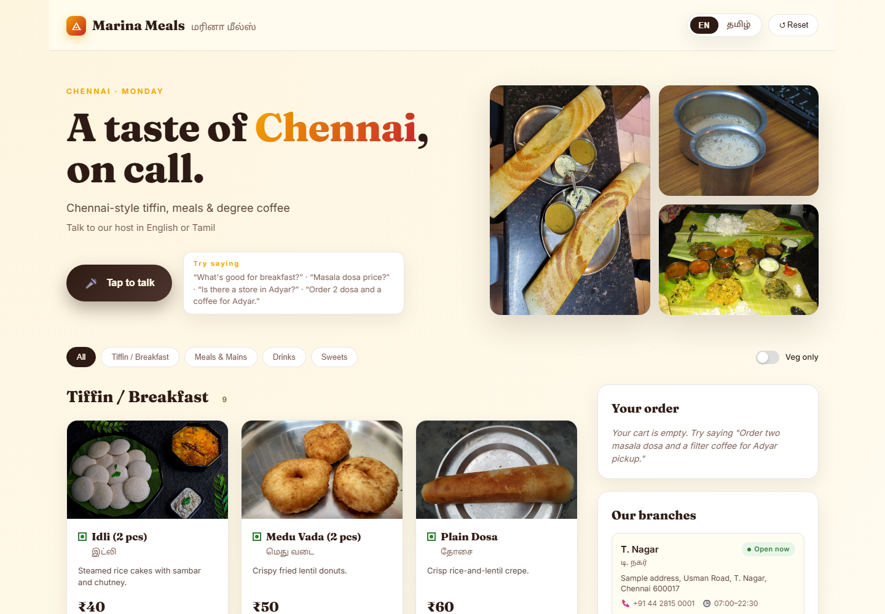
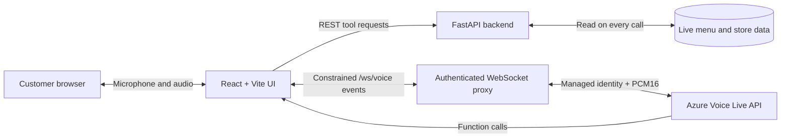

# Marina Meals

<p align="center">
  
</p>

<p align="center">
  <strong>A Chennai-inspired restaurant experience powered by Azure Voice Live.</strong><br>
  Ask about the menu, find a branch, or place an order by speaking in English or Tamil.
</p>

<p align="center">
  <a href="https://github.com/sauravraghuvanshi/marina-meals/releases/tag/v1.0-demo">
    
  </a>
  
  
  
</p>

## What is Marina Meals?

Marina Meals is an end-to-end voice ordering demo for a fictional Chennai restaurant. It combines a responsive menu and branch interface with a real-time conversational host built on the **Azure Voice Live API** in the **new Azure AI Foundry**.

The customer can speak naturally instead of navigating a traditional ordering flow:

- ask which dishes are available;
- request an exact current price;
- view or hear today's specials;
- find a nearby branch and its opening hours;
- place a pickup order and receive a server-calculated total;
- switch between English and Tamil conversation.

Restaurant facts are never generated from model memory. Prices, availability, stores, and order totals come from backend tools that read the current restaurant data.

## Demo walkthrough

The complete project walkthrough is published as a GitHub Release asset so the repository remains lightweight.

- [Watch or download the Marina Meals demo](https://github.com/sauravraghuvanshi/marina-meals/releases/download/v1.0-demo/Marina.Meals.Demo.mp4)
- [Open the demo release page](https://github.com/sauravraghuvanshi/marina-meals/releases/tag/v1.0-demo)

## Example use cases

| Use case | Example |
|---|---|
| Menu discovery | "What's available for breakfast?" |
| Live price and availability | "How much is a masala dosa?" |
| Visual menu results | "Show me today's specials." |
| Spoken menu results | "Tell me your top five dishes." |
| Branch discovery | "Is there a Marina Meals in Adyar?" |
| Voice ordering | "Order two masala dosa and one filter coffee for Adyar pickup." |
| Tamil conversation | Ask a complete question in Tamil and receive a Tamil response. |
| Live-data demonstration | Change a price or availability flag in JSON and ask again without restarting the backend. |

## Highlights

- **Real-time bilingual voice:** PCM16 mono audio at 24 kHz with semantic voice activity detection and barge-in.
- **English-first language behavior:** Tamil replies are used only for complete Tamil utterances.
- **Tool-grounded answers:** menu, price, availability, branch, and order facts come from backend functions.
- **Server-side totals:** the model never calculates money or invents confirmation numbers.
- **Show versus tell:** visual requests open a menu panel; spoken requests remain audio-only.
- **Live restaurant data:** menu and store JSON files are re-read for every tool call.
- **Responsive Chennai theme:** coffee brown, turmeric, banana-leaf green, cream, and Tamil-capable typography.
- **Managed identity security:** Azure credentials and Voice Live authorization remain on the server.

## How it works



1. The browser requests a short-lived, single-use session ticket from the backend.
2. The backend validates the user's Microsoft Entra identity and WebSocket origin.
3. The backend opens Azure Voice Live with its managed identity.
4. The server sends the authoritative prompt, tools, voice, and language configuration.
5. Voice Live handles speech recognition, reasoning, and speech synthesis.
6. Function calls are dispatched to the restaurant tools, and their results are returned to the model and reflected in the UI.

The browser never receives an Azure access token, API key, or Azure resource credential.

## Technology

| Layer | Technology |
|---|---|
| Frontend | React 18, TypeScript, Vite, Web Audio API |
| Backend | Python, FastAPI, Uvicorn/Gunicorn |
| Conversation | Azure Voice Live API |
| AI platform | Azure AI Foundry with a latest-GA realtime model deployment |
| Authentication | Microsoft Entra ID, App Service Authentication, managed identity |
| Data | JSON today; tool contracts can later point to a database or POS API |

## Run locally

### Prerequisites

- Node.js 20 or newer
- Python 3.11 or newer
- Azure CLI
- An Azure AI Foundry project with:
  - an AI Services resource that supports Voice Live;
  - a latest-GA realtime model deployment;
  - `Cognitive Services User` and `Foundry User` assigned to your signed-in Azure principal.

Confirm the current supported region, GA model, endpoint format, and Voice Live API version in the [Azure Voice Live documentation](https://learn.microsoft.com/azure/ai-services/speech-service/voice-live).

### 1. Clone the repository

```powershell
git clone https://github.com/sauravraghuvanshi/marina-meals.git
Set-Location marina-meals
```

### 2. Configure the backend

```powershell
Copy-Item backend\.env.example backend\.env
```

Edit `backend\.env`:

```dotenv
AZURE_SPEECH_ENDPOINT=https://<your-foundry-resource>.services.ai.azure.com
AZURE_SPEECH_REGION=<resource-region>
VOICE_LIVE_MODEL=<latest-ga-deployment-name>
VOICE_LIVE_API_VERSION=<current-ga-api-version>
TTS_VOICE=ta-IN-PallaviNeural
STT_LANGUAGES=en-IN,ta-IN

# Local development only
REQUIRE_APP_AUTH=false
ALLOWED_ORIGINS=http://localhost:5173,http://127.0.0.1:5173
```

No Azure key is required. `DefaultAzureCredential` uses your Azure CLI sign-in:

```powershell
az login
python -m pip install -r backend\requirements.txt
python -m uvicorn backend.main:app --reload --port 8000
```

### 3. Start the frontend

In a second terminal:

```powershell
Set-Location frontend
npm ci
npm run dev
```

Open [http://localhost:5173](http://localhost:5173), allow microphone access, and select **Tap to talk**.

## Deploy securely to Azure App Service

This project uses a Linux App Service for the FastAPI API, compiled frontend, and authenticated Voice Live WebSocket proxy. The following flow creates the hosting layer. Create the Foundry resource and latest-GA model deployment first in [Azure AI Foundry](https://ai.azure.com/).

### 1. Set deployment variables

```powershell
$subscriptionId = "<subscription-id>"
$resourceGroup = "<resource-group>"
$location = "<app-service-region>"
$planName = "<app-service-plan>"
$appName = "<globally-unique-app-name>"
$aiResourceName = "<ai-services-resource-name>"

$foundryEndpoint = "https://<your-foundry-resource>.services.ai.azure.com"
$speechRegion = "<ai-resource-region>"
$modelDeployment = "<latest-ga-deployment-name>"
$voiceLiveApiVersion = "<current-ga-api-version>"
$tenantId = "<entra-tenant-id>"
$clientId = "<entra-app-registration-client-id>"

az account set --subscription $subscriptionId
az group create --name $resourceGroup --location $location
```

### 2. Create App Service with managed identity

```powershell
az appservice plan create `
  --resource-group $resourceGroup `
  --name $planName `
  --is-linux `
  --sku B1

az webapp create `
  --resource-group $resourceGroup `
  --plan $planName `
  --name $appName `
  --runtime "PYTHON:3.12" `
  --assign-identity

az webapp config set `
  --resource-group $resourceGroup `
  --name $appName `
  --web-sockets-enabled true `
  --startup-file "gunicorn -k uvicorn.workers.UvicornWorker backend.main:app --bind 0.0.0.0:8000 --workers 1 --timeout 600"
```

The demo's single-use tickets are held in process memory, so the supplied startup command intentionally uses one worker. For multi-instance production scaling, move ticket storage to a shared service such as Azure Cache for Redis.

### 3. Grant the managed identity access to Azure AI

```powershell
$principalId = az webapp identity show `
  --resource-group $resourceGroup `
  --name $appName `
  --query principalId `
  --output tsv

$aiResourceId = az cognitiveservices account show `
  --resource-group $resourceGroup `
  --name $aiResourceName `
  --query id `
  --output tsv

az role assignment create `
  --assignee-object-id $principalId `
  --assignee-principal-type ServicePrincipal `
  --role "Cognitive Services User" `
  --scope $aiResourceId

az role assignment create `
  --assignee-object-id $principalId `
  --assignee-principal-type ServicePrincipal `
  --role "Foundry User" `
  --scope $aiResourceId
```

### 4. Require Microsoft Entra authentication

In the Azure portal:

1. Open the App Service and select **Authentication**.
2. Add **Microsoft** as the identity provider.
3. Create or select an app registration for this web app.
4. Require authentication for all requests.
5. Set unauthenticated requests to **HTTP 401 Unauthorized**.
6. Enable the authentication token store.
7. Record the app registration client ID and tenant ID.

Production authentication is intentionally fail-closed. Do not set `REQUIRE_APP_AUTH=false` on Azure.

### 5. Configure application settings

```powershell
$appOrigin = "https://$appName.azurewebsites.net"

az webapp config appsettings set `
  --resource-group $resourceGroup `
  --name $appName `
  --settings `
    AZURE_SPEECH_ENDPOINT=$foundryEndpoint `
    AZURE_SPEECH_REGION=$speechRegion `
    VOICE_LIVE_MODEL=$modelDeployment `
    VOICE_LIVE_API_VERSION=$voiceLiveApiVersion `
    TTS_VOICE=ta-IN-PallaviNeural `
    STT_LANGUAGES=en-IN,ta-IN `
    REQUIRE_APP_AUTH=true `
    ENTRA_TENANT_ID=$tenantId `
    ENTRA_CLIENT_ID=$clientId `
    ALLOWED_ORIGINS=$appOrigin `
    SCM_DO_BUILD_DURING_DEPLOYMENT=true
```

### 6. Build and deploy

From the repository root:

```powershell
Push-Location frontend
npm ci
npm run build
Pop-Location

Copy-Item backend\requirements.txt requirements.txt

$package = Join-Path $env:TEMP "marina-meals-deploy.zip"
Remove-Item $package -ErrorAction SilentlyContinue
Compress-Archive `
  -Path backend,data,frontend\dist,requirements.txt `
  -DestinationPath $package

Remove-Item requirements.txt

az webapp deploy `
  --resource-group $resourceGroup `
  --name $appName `
  --src-path $package `
  --type zip
```

Open `https://<your-app-name>.azurewebsites.net`, sign in, allow microphone access, and start a conversation.

### 7. Verify the deployment

```powershell
Start-Process "https://$appName.azurewebsites.net/api/health"
```

Sign in when prompted. The expected response is:

```json
{ "status": "ok" }
```

Then verify manually:

1. the proactive greeting is in English;
2. menu prices match `data/menu.json`;
3. a complete Tamil question receives a Tamil answer;
4. interrupting the agent stops current playback;
5. an order total matches the server-computed cart;
6. an unauthenticated request is rejected.

## Customize the restaurant data

The application intentionally keeps its demo data simple:

- `data/menu.json` contains categories, English and Tamil names, prices, availability, specials, and image URLs.
- `data/stores.json` contains branch names, addresses, hours, phone numbers, and map coordinates.

The backend reads both files on every tool call. Edit the JSON and ask the same question again to demonstrate real-time grounding without restarting the backend.

The included addresses and phone numbers are illustrative demo data, not real business details.

## Test and build

```powershell
python -m pytest backend\tests -q

Push-Location frontend
npm ci
npm run build
Pop-Location
```

The backend suite covers tool matching, Tamil names, live-data updates, server-side totals, Entra token validation, ticket replay protection, WebSocket event filtering, origin checks, and static-file containment.

## Project structure

```text
marina-meals/
├── backend/
│   ├── main.py                 # FastAPI routes and authenticated WebSocket proxy
│   ├── tools.py                # Live menu, store, and order functions
│   ├── voice_config.py         # Server-owned Voice Live prompt and tool definitions
│   └── tests/                  # Backend and security tests
├── data/
│   ├── menu.json
│   └── stores.json
├── docs/images/                # README product screenshots
├── frontend/
│   ├── public/                 # AudioWorklet and favicon
│   └── src/                    # React UI, audio pipeline, and Voice Live client
├── implementation.md           # Detailed behavior and acceptance specification
└── README.md
```

## Important production considerations

- Use only latest stable GA models and API versions supported by your Foundry region.
- Keep `REQUIRE_APP_AUTH=true` outside local development.
- Never place Azure keys, bearer tokens, tenant details, or concrete resource endpoints in source control.
- Use managed identity and least-privilege role assignments.
- Replace JSON with a durable database or POS integration before using the ordering flow for real customers.
- Add shared ticket storage, rate limiting, monitoring, and a paid App Service plan before scaling beyond a controlled demo.

## Further reading

- [Azure Voice Live overview](https://learn.microsoft.com/azure/ai-services/speech-service/voice-live)
- [Azure AI Foundry](https://ai.azure.com/)
- [Detailed implementation specification](implementation.md)
